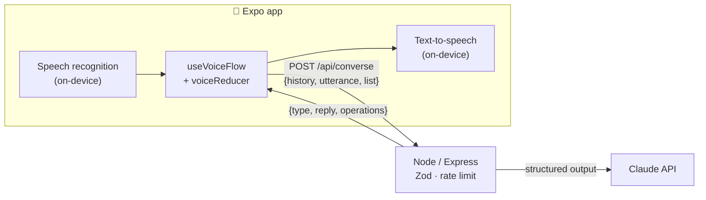

# VoiceFlow

**A hands-free, voice-first list assistant for iOS and Android, built with React Native, Expo and Claude.**

Tap the mic and talk naturally: *"add eggs, bread and coffee"*, *"take the bread off"*, *"what's on my list?"* VoiceFlow transcribes your speech on the device, sends the text to Claude, which works out what you meant and returns structured list changes, and then speaks the reply back to you.


<!-- Add a demo GIF/screenshots to docs/screenshots and reference them here -->

## Highlights

- **Real voice loop**: on-device speech recognition with live partial transcripts → Claude → on-device text-to-speech. Barge-in is supported: tap the mic while it's speaking to interrupt.
- **Structured AI output**: Claude answers against a strict JSON schema (`reply`, `type`, `operations[]`), so the app never parses free text to update state.
- **Clarification flow**: when a request is ambiguous ("remove it"), the assistant asks a follow-up instead of guessing, and the UI renders it differently.
- **Typed state machine**: the whole voice loop is a pure reducer (`Idle → Listening → Thinking → Speaking`). It is unit-tested and immune to late native callbacks.
- **Secure by design**: the API key lives only on the server. The backend validates input with Zod, caps payload size and rate-limits per client.
- **Works offline for demos**: with no server configured, a keyword-based demo assistant runs instead. A dev bar lets you force the clarification, network-error and server-error states.
- **Resilience**: request timeouts, friendly error messages for every recognizer error code, a graceful reply on model refusal, and server-side model fallback.

## Architecture



| Layer | Choice | Why |
|---|---|---|
| Speech-to-text | `expo-speech-recognition` (Apple Speech / Android SpeechRecognizer) | Free, low latency, streaming partial results, no audio upload |
| Reasoning | Claude via `@anthropic-ai/sdk`, structured outputs | Reliable intent and entity extraction from imperfect transcripts |
| Text-to-speech | `expo-speech` | Instant, offline, completion callbacks drive the state machine |
| Backend | Express 5 + Zod | Keeps the API key off the device, validates every request |
| Contract | `shared/contract.ts` | One set of request/response types imported by both app and server |

Because the server only ever sees text, cloud speech providers (Whisper, Deepgram, ElevenLabs) can be added later without changing the app ↔ server contract.

## Project structure

```
App.tsx                    Screen layout
src/
  core/voiceMachine.ts     Pure state machine + list operations (unit-tested)
  hooks/useVoiceFlow.ts    Wires native speech events and async effects to the reducer
  services/
    Assistant.ts           HttpAssistant (server) and DemoAssistant (offline)
    SpeechInput.ts         Speech recognition wrapper + error-code messages
    SpeechOutput.ts        Text-to-speech wrapper
    Analytics.ts           Event log (swap for a real sink)
  components/              MicButton, ListeningOverlay, ListPanel, TranscriptList, …
shared/contract.ts         App ↔ server API types and limits
server/
  src/assistant.ts         Claude prompt, schema and call
  src/app.ts               Express app: validation, rate limiting, error mapping
```

## Getting started

**Requirements:** Node 20.11+, Xcode (iOS) or Android Studio (Android). Speech recognition is a native module, so the app runs as a [development build](https://docs.expo.dev/develop/development-builds/introduction/), not in Expo Go.

### 1. Run the server

```bash
cd server
npm install
cp .env.example .env        # then set ANTHROPIC_API_KEY
npm run dev                 # http://localhost:8787
```

### 2. Run the app

```bash
npm install
cp .env.example .env        # set EXPO_PUBLIC_API_URL (or leave empty for demo mode)
npm run ios                 # or: npm run android
```

`EXPO_PUBLIC_API_URL` values:
- iOS simulator: `http://localhost:8787`
- Android emulator: `http://10.0.2.2:8787`
- Physical device: `http://<your-computer-LAN-IP>:8787` (same Wi-Fi network)

The header badge shows **Claude** when the app is connected to the server and **Demo** when it's using the offline assistant.

## Testing

```bash
npm run typecheck   # app + server
npm test            # state machine, API validation, rate limiting, Claude client (mocked)
```

The same checks run in GitHub Actions on every push.

## API

`POST /api/converse`

```jsonc
// request
{ "history": [{ "role": "user", "text": "add milk" }, { "role": "assistant", "text": "Added milk." }],
  "utterance": "and two kinds of cheese",
  "list": ["milk"] }

// response
{ "type": "answer",
  "reply": "Added cheddar and brie.",
  "operations": [{ "action": "add", "item": "cheddar" }, { "action": "add", "item": "brie" }] }
```

Errors return `{ "error": { "code": "BAD_REQUEST" | "RATE_LIMITED" | "UPSTREAM" | "INTERNAL", "message": "…" } }`.

## Roadmap

- Persist lists on the device, with support for multiple named lists
- Stream replies sentence by sentence into TTS for lower perceived latency
- Optional cloud voices (ElevenLabs/OpenAI TTS) behind the same contract
- Hold-to-talk mode and haptic feedback

## License

MIT
